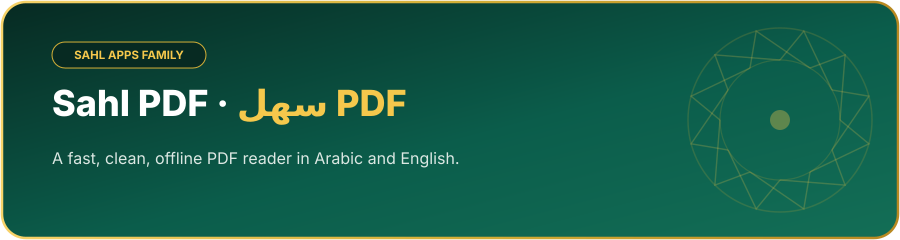

  

---

## ✨ Highlights

| Feature | What it gives you |
|---|---|
| 📄 **Smooth PDF Reading** | Fast page rendering, pinch-to-zoom, and jump-to-page for books and documents. |
| 📖 **Comfortable Reading Modes** | Includes dark/night reading comfort and distraction-free full-screen view. |
| 🔍 **Text & Document Tools** | Search inside documents, view outlines/bookmarks, and share pages easily. |
| 🌙 **Sahl Family Design** | Clean Arabic & English interface with zero ads and zero tracking. |

---

## 📲 Install in Seconds

1. Tap **[Download Latest APK](https://github.com/AliSherif1309/SahlPDF/releases/latest)** above.
2. Open the downloaded `.apk` file on your Android phone to install.
3. **Sahl PDF** checks for new versions automatically so you stay up to date in one tap.

---

## 🌿 The Sahl Apps Family · عائلة تطبيقات سهل

A calm, ad-free, bilingual (**Arabic & English**) suite of everyday Android apps crafted in **Emerald & Gold**:

[🎨 Sahl Theme](https://github.com/AliSherif1309/SahlHome) · [🕌 Sahl Adhan](https://github.com/AliSherif1309/SahlAdhan) · [🧭 Sahl Qibla](https://github.com/AliSherif1309/SahlQibla) · [📞 Sahl Phone](https://github.com/AliSherif1309/SahlPhone) · [👤 Sahl Contacts](https://github.com/AliSherif1309/SahlContacts) · [💬 Sahl Messages](https://github.com/AliSherif1309/SahlMessages) · [📷 Sahl Camera](https://github.com/AliSherif1309/SahlCamera) · [🖼️ Sahl Gallery](https://github.com/AliSherif1309/SahlGallery) · [📁 Sahl Files](https://github.com/AliSherif1309/SahlFiles) · [🛠️ Sahl Tools](https://github.com/AliSherif1309/SahlTools) · [☁️ Sahl Sync](https://github.com/AliSherif1309/SahlSync) · [📺 Sahl TV](https://github.com/AliSherif1309/SahlTV-Launcher)
